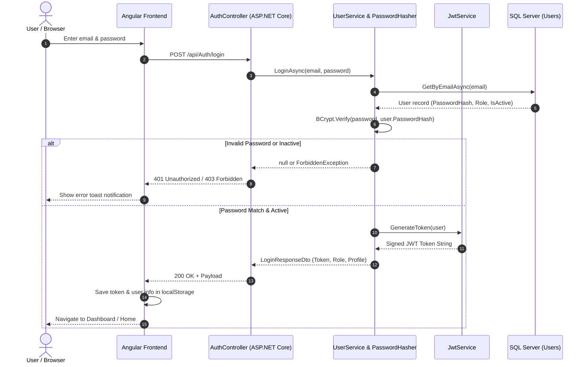

# QuickEats - Authentication & Authorization Guide

## 1. Overview & Philosophy
Security in QuickEats is built around **stateless JSON Web Tokens (JWT)** and **Role-Based Access Control (RBAC)**.
- **Frontend:** Angular 21 (Standalone components) stores the token in `localStorage`, attaches it automatically to outgoing HTTP calls via an `HttpInterceptorFn`, and controls route access using functional route guards (`CanActivateFn`).
- **Backend:** ASP.NET Core 8 Web API verifies incoming tokens using `Microsoft.AspNetCore.Authentication.JwtBearer`, validates cryptographic signatures, and authorizes controller endpoints using `[Authorize(Roles = "...")]` attributes.

---

## 2. Authentication Flow Diagram



---

## 3. Password Hashing with BCrypt.Net-Next

In QuickEats, passwords are **never stored in plain text**. We use `BCrypt.Net-Next` with automatic cryptographic salting.

### Implementation: `PasswordHasher.cs`
```csharp
namespace QuickEats.API.Helpers
{
    public class PasswordHasher
    {
        public static string Hash(string password)
        {
            // BCrypt automatically creates a unique 128-bit salt and hashes the password
            return BCrypt.Net.BCrypt.HashPassword(password);
        }

        public static bool Verify(string password, string hash)
        {
            // Extracts the salt from the hash and verifies the cleartext candidate
            return BCrypt.Net.BCrypt.Verify(password, hash);
        }
    }
}
```

### Why BCrypt is preferred over SHA-256 / MD5:
1. **Adaptive Work Factor (Cost Factor):** BCrypt is intentionally slow. It forces attackers attempting brute-force or dictionary attacks to spend significant computational time per hash.
2. **Automatic Salt Injection:** The generated hash contains the salt, cost parameter, and digest inside a single 60-character string (e.g., `$2a$11$...`).
3. **Rainbow Table Immunity:** Every user gets a unique salt even if two users choose the identical password `"Password@123"`.

---

## 4. JWT Token Structure & Generation

### Implementation: `JwtService.cs`
```csharp
public class JwtService : IJwtService
{
    private readonly JwtSettings _jwtSettings;

    public JwtService(IOptions<JwtSettings> jwtSettings)
    {
        _jwtSettings = jwtSettings.Value;
    }

    public string GenerateToken(User user)
    {
        var key = Encoding.UTF8.GetBytes(_jwtSettings.Key);
        var claims = new List<Claim>
        {
            new Claim(ClaimTypes.NameIdentifier, user.Id.ToString()),
            new Claim(ClaimTypes.Name, user.Name),
            new Claim(ClaimTypes.Email, user.Email),
            new Claim(ClaimTypes.Role, user.Role)
        };

        var securityKey = new SymmetricSecurityKey(key);
        var credentials = new SigningCredentials(securityKey, SecurityAlgorithms.HmacSha256);

        var token = new JwtSecurityToken(
            issuer: _jwtSettings.Issuer,
            audience: _jwtSettings.Audience,
            claims: claims,
            expires: DateTime.UtcNow.AddMinutes(_jwtSettings.ExpiresInMinutes),
            signingCredentials: credentials);

        return new JwtSecurityTokenHandler().WriteToken(token);
    }
}
```

### Anatomy of QuickEats JWT:
1. **Header:** `{"alg": "HS256", "typ": "JWT"}`
2. **Payload (Claims):**
   - `sub / NameIdentifier`: User's numeric database primary key (`user.Id`)
   - `name`: User's full name (displayed in the top navbar)
   - `email`: Registered email address
   - `role`: One of `Customer`, `Owner`, `Admin`, `DeliveryPartner`
   - `exp`: Expiration Unix timestamp (`AddMinutes(ExpiresInMinutes)`)
3. **Signature:** `HMACSHA256(base64UrlEncode(header) + "." + base64UrlEncode(payload), secretKey)`

---

## 5. ASP.NET Core Middleware Configuration (`Program.cs`)

```csharp
// 1. Read & Validate JWT Configuration (Fail-fast, zero hardcoded fallback)
builder.Services.Configure<JwtConfig>(builder.Configuration.GetSection("Jwt"));
var jwtConfig = builder.Configuration.GetSection("Jwt").Get<JwtConfig>();

if (jwtConfig == null || string.IsNullOrWhiteSpace(jwtConfig.Key))
{
    throw new InvalidOperationException(
        "JWT signing key is missing. Set 'Jwt:Key' in configuration or environment variables.");
}

if (Encoding.UTF8.GetByteCount(jwtConfig.Key) < 32)
{
    throw new InvalidOperationException(
        "JWT signing key must be at least 256 bits (32 bytes).");
}

// 2. Register Authentication Handler
builder.Services.AddAuthentication(options =>
{
    options.DefaultAuthenticateScheme = JwtBearerDefaults.AuthenticationScheme;
    options.DefaultChallengeScheme = JwtBearerDefaults.AuthenticationScheme;
})
.AddJwtBearer(options =>
{
    options.RequireHttpsMetadata = false; // Set true in strict production SSL environments
    options.SaveToken = true;
    options.TokenValidationParameters = new TokenValidationParameters
    {
        ValidateIssuer = true,
        ValidateAudience = true,
        ValidateLifetime = true,
        ValidateIssuerSigningKey = true,
        ValidIssuer = jwtConfig.Issuer,
        ValidAudience = jwtConfig.Audience,
        IssuerSigningKey = new SymmetricSecurityKey(Encoding.UTF8.GetBytes(jwtConfig.Key)),
        ClockSkew = TimeSpan.Zero // Strict token expiration check without 5-min tolerance
    };
});

// 3. Register Authorization Engine
builder.Services.AddAuthorization();

// 4. HTTP Request Pipeline Order
app.UseAuthentication(); // First: Identifies who you are (reads & validates token)
app.UseAuthorization();  // Second: Verifies what you are allowed to do (checks roles)
```

---

## 6. Frontend Token Injection: `authInterceptor`

Angular 21 functional HTTP interceptor injects the `Bearer` token on all outbound requests:

```typescript
// auth.interceptor.ts
import { HttpInterceptorFn } from '@angular/common/http';

export const authInterceptor: HttpInterceptorFn = (req, next) => {
  const token = localStorage.getItem('token');

  if (token) {
    req = req.clone({
      setHeaders: {
        Authorization: `Bearer ${token}`
      }
    });
  }

  return next(req);
};
```

Registered in `app.config.ts`:
```typescript
export const appConfig: ApplicationConfig = {
  providers: [
    provideRouter(routes),
    provideHttpClient(withInterceptors([authInterceptor]))
  ]
};
```

---

## 7. Role-Based Route Guards (`CanActivateFn`)

In Angular 21, functional route guards protect routes from unauthorized navigation:

```typescript
// auth.guard.ts
export const authGuard: CanActivateFn = (route, state) => {
  const router = inject(Router);
  const token = localStorage.getItem('token');

  if (token) {
    return true;
  }

  router.navigate(['/login'], { queryParams: { returnUrl: state.url } });
  return false;
};

// owner.guard.ts
export const ownerGuard: CanActivateFn = () => {
  const router = inject(Router);
  const role = localStorage.getItem('role');

  if (role === 'Owner') {
    return true;
  }

  router.navigate(['/']);
  return false;
};
```

---

## 8. Common Interview Q&A on Auth

### Q1: What happens if an expired JWT is sent to the backend?
**Answer:** The `JwtBearer` middleware evaluates the `exp` claim against `DateTime.UtcNow`. Because we set `ClockSkew = TimeSpan.Zero`, any expired token immediately fails token validation and returns an HTTP `401 Unauthorized` before reaching any controller action.

### Q2: Why store JWT in `localStorage` instead of cookies?
**Answer:** `localStorage` is simple for Single Page Applications (SPAs) and avoids Cross-Site Request Forgery (CSRF) vulnerability by default since browsers don't automatically send `localStorage` keys with cross-origin requests. However, it is vulnerable to XSS if malicious scripts can run. For higher enterprise security, `HttpOnly` SameSite cookies can be used.

### Q3: How do we prevent a Restaurant Owner from editing another owner's restaurant?
**Answer:** We enforce data-level ownership checks inside the controller:
```csharp
var currentUserId = int.Parse(User.FindFirstValue(ClaimTypes.NameIdentifier)!);
var restaurant = await _restaurantRepository.GetByIdAsync(restaurantId);
if (restaurant.OwnerId != currentUserId && !User.IsInRole("Admin"))
{
    return Forbid(); // HTTP 403
}
```
Public browsing endpoints (`GET /api/Restaurant/{id}`) are left open so that all users can browse food and menus.
