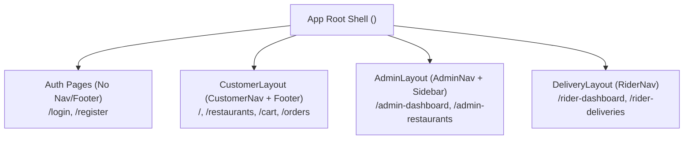

# QuickEats - Frontend Architecture & Angular Implementation Guide

## 1. Overview & Modern Angular Standards
The QuickEats frontend is developed using **Angular 21**, representing the modern era of Angular architecture:
- **Standalone Components:** 100% standalone — no legacy `NgModule` declarations.
- **Signals-Driven Reactive State:** State management for shopping cart, delivery calculations, and coupons leverages Angular Signals (`signal<T>()`, `computed()`) for fine-grained reactivity.
- **Modern Routing & Multi-Layout Architecture:** Separate layouts for Customer, Delivery Partner, and Admin sections.
- **Functional Interceptors & Route Guards:** Lightweight, composable functions replacing legacy class-based interceptors and guards.
- **SCSS Design System:** Structured CSS custom properties (variables), responsive flex/grid layouts, and clean UI components.

---

## 2. Directory Structure

```text
frontend/quickeats-web/src/app/
├── app.config.ts               # Core dependency injection providers
├── app.routes.ts               # Application route table & guard configurations
├── app.component.ts            # Root application shell
├── core/
│   ├── models/                 # TypeScript data contracts (User, Order, Restaurant, etc.)
│   └── services/               # Singleton business logic (AuthService, CartService, etc.)
├── features/
│   ├── admin/                  # Admin portal (dashboard, orders, restaurants, users, coupons)
│   ├── auth/                   # Login & registration forms
│   ├── customer/               # Home, restaurants, menu, cart, checkout, tracking, reviews
│   ├── delivery-partner/       # Rider dashboard, active deliveries, delivery history
│   └── owner/                  # Restaurant owner dashboard, menu editor, live order board
├── guards/                     # authGuard, adminGuard, ownerGuard, deliveryPartnerGuard
├── interceptors/               # authInterceptor (JWT token bearer injection)
└── layout/                     # customer-layout, delivery-layout, navbar, footer
```

---

## 3. State Management with Angular Signals (`CartService`)

Instead of pulling heavy state libraries (like NgRx or Redux) for a food delivery cart, QuickEats uses native **Angular Signals**.

### Why Signals?
1. **Fine-grained reactivity:** Only components reading the changed signal re-render, eliminating global change detection overhead (`Zone.js` optimization).
2. **Synchronous, glitch-free reads:** Read `cartItems()` like a simple function call without subscribing or managing unsubscribe lifecycles.
3. **Derived state:** `computed()` properties automatically re-evaluate only when their dependencies change.

### `CartService` Implementation Example:
```typescript
@Injectable({
  providedIn: 'root'
})
export class CartService {
  // Primary reactive signals
  cartItems = signal<CartItem[]>([]);
  deliveryCharge = signal<number>(40);
  appliedCoupon = signal<CouponModel | null>(null);

  // Add Item to Cart
  addToCart(menu: MenuItem): void {
    const items = [...this.cartItems()];
    const existing = items.find(x => x.menu.id === menu.id);

    if (existing) {
      existing.quantity++;
    } else {
      items.push({ menu, quantity: 1 });
    }

    this.cartItems.set(items);
  }

  // Get Subtotal
  getFoodTotal(): number {
    return this.cartItems().reduce(
      (total, item) => total + (item.menu.price * item.quantity), 
      0
    );
  }

  // Compute Final Pay Amount
  getGrandTotal(): number {
    const subtotal = this.getFoodTotal();
    const discount = this.getDiscountAmount();
    const delivery = subtotal >= 500 ? 0 : this.deliveryCharge();
    return Math.max(0, subtotal - discount + delivery);
  }
}
```

---

## 4. Multi-Layout Routing Architecture

QuickEats organizes the user experience into four distinct layout contexts:



### Route Guard Configuration in `app.routes.ts`:
```typescript
export const routes: Routes = [
  // Public Auth Pages
  { path: 'login', component: LoginComponent },
  { path: 'register', component: RegisterComponent },

  // Customer Pages wrapped in CustomerLayout
  {
    path: '',
    component: CustomerLayout,
    children: [
      { path: '', component: Home },
      { path: 'restaurants', component: RestaurantsComponent },
      { path: 'restaurant/:id', component: RestaurantDetailsComponent },
      { path: 'cart', component: CartComponent },
      { path: 'checkout', component: CheckoutComponent, canActivate: [authGuard] },
      { path: 'my-orders', component: OrderHistoryComponent, canActivate: [authGuard] }
    ]
  },

  // Owner Portal
  {
    path: 'owner-dashboard',
    component: OwnerDashboardComponent,
    canActivate: [authGuard, ownerGuard]
  },

  // Admin Portal
  {
    path: 'admin-dashboard',
    component: AdminDashboard,
    canActivate: [authGuard, adminGuard]
  },

  // Rider Portal
  {
    path: 'rider-dashboard',
    component: RiderDashboardComponent,
    canActivate: [authGuard, deliveryPartnerGuard]
  }
];
```

---

## 5. Modern Dependency Injection (`app.config.ts`)

In modern standalone Angular, providers are declared in `ApplicationConfig`:

```typescript
export const appConfig: ApplicationConfig = {
  providers: [
    provideRouter(routes, withViewTransitions()),
    provideHttpClient(
      withInterceptors([authInterceptor])
    ),
    provideToastr({
      timeOut: 3000,
      positionClass: 'toast-bottom-right',
      preventDuplicates: true
    })
  ]
};
```

---

## 6. Frontend Testing Strategy (Vitest)

QuickEats uses **Vitest** for ultrafast unit testing of Angular standalone components and services:
- **Zero Karma / Webpack overhead:** Runs directly with native ESM.
- **Provider Scaffolding Pattern:**
```typescript
beforeEach(async () => {
  await TestBed.configureTestingModule({
    imports: [RestaurantsComponent],
    providers: [
      provideHttpClient(),
      provideHttpClientTesting(),
      provideRouter([]),
      provideToastr()
    ]
  }).compileComponents();
});
```
- **Test Results:** 45 spec files passing (100% pass rate).

---

## 7. Frontend Interview Questions & Answers

### Q1: What are Standalone Components and why use them?
**Answer:** Standalone components were introduced in Angular 14 and became the recommended standard in Angular 17+. They eliminate `NgModule`, meaning a component directly imports what it needs (like `CommonModule`, `FormsModule`, `RouterLink`) in its `@Component({ imports: [...] })` array. This results in faster build times, cleaner code, and easier tree-shaking.

### Q2: How do Angular Signals differ from RxJS Observables?
**Answer:**
- **Observables:** Great for asynchronous events, streaming websockets, debounced search inputs, and cancellation (`switchMap`).
- **Signals:** Synchronous reactive primitives that hold a value. You don't need `.subscribe()` or async pipe (`| async`), avoiding memory leaks. When a signal value updates, Angular knows exactly which DOM nodes depend on it and updates them directly.

### Q3: How does the functional `HttpInterceptorFn` work?
**Answer:** Unlike the older class-based `HttpInterceptor` that implemented an interface, `HttpInterceptorFn` is a pure function `(req, next) => next(req)`. It clones the request to attach HTTP headers (like `Authorization: Bearer <token>`) and passes it down the pipeline. It is registered simply via `withInterceptors([authInterceptor])`.
