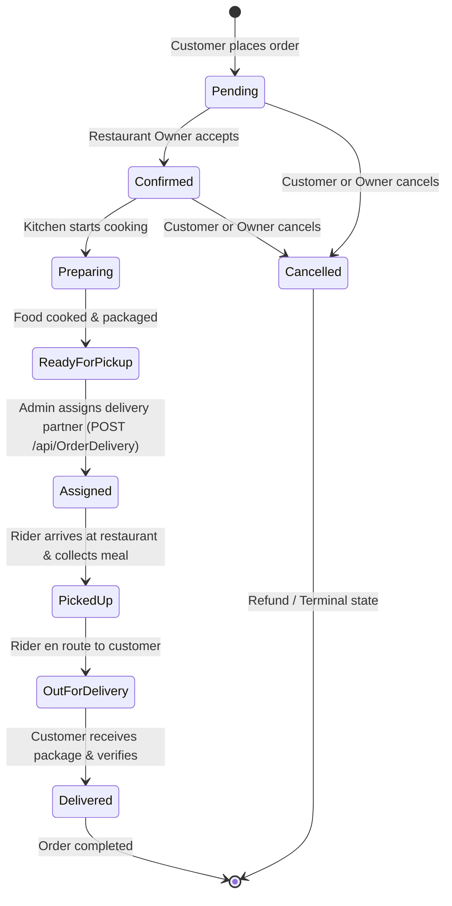

# QuickEats - Order Lifecycle & State Machine Architecture

## 1. Overview & Business Problem
In a food delivery platform, an order is a legal and operational contract between four distinct actors:
1. **Customer:** Places the order and pays for items.
2. **Restaurant Owner / Kitchen:** Prepares food, manages inventory, and packages the meal.
3. **Delivery Partner (Rider):** Dispatches to the restaurant, collects the package, and delivers it to the customer's doorstep.
4. **Platform Administrator:** Monitors service levels and handles dispute resolutions.

Allowing arbitrary status jumps (e.g. going from `Delivered` back to `Pending` or from `Out for Delivery` to `Cancelled` without payment/audit tracking) causes inventory discrepancies, lost revenue, and bad user experience. QuickEats solves this using a **deterministic Finite State Machine (FSM)** enforced in `OrderService.cs`.

---

## 2. Order State Machine Diagram



---

## 3. Transition Rules & Permitted Actors

| Current Status | Permitted Next Status | Triggering Actor | Business Condition / Constraint |
|---|---|---|---|
| `Pending` | `Confirmed` | Restaurant Owner | Restaurant verifies items and kitchen capacity |
| `Pending` | `Cancelled` | Customer / Owner | Instant cancellation before prep begins |
| `Confirmed` | `Preparing` | Restaurant Owner | Kitchen actively begins preparing food |
| `Confirmed` | `Cancelled` | Customer / Owner | Last allowed stage for customer cancellation |
| `Preparing` | `Ready for Pickup` | Restaurant Owner | Meal boxed, sealed, waiting on pickup counter |
| `Ready for Pickup`| `Assigned` | Platform Admin | Admin assigns active rider via `POST /api/OrderDelivery` |
| `Assigned` | `Picked Up` | Delivery Partner | Partner confirms pickup at restaurant counter |
| `Picked Up` | `Out for Delivery` | Delivery Partner | Partner begins bike/vehicle navigation |
| `Out for Delivery`| `Delivered` | Delivery Partner | Delivered to customer doorstep; COD collected |
| `Delivered` | *None (Terminal)* | — | No further automatic transitions permitted |
| `Cancelled` | *None (Terminal)* | — | No further automatic transitions permitted |

---

## 4. Backend Implementation (`OrderService.cs`)

### 4.1 Legal State Transitions Map
```csharp
private static void ValidateStatusTransition(string currentStatus, string newStatus)
{
    // Idempotent calls (no change) are accepted cleanly
    if (string.Equals(newStatus, currentStatus, StringComparison.OrdinalIgnoreCase))
    {
        return;
    }

    var allowedTransitions = new Dictionary<string, HashSet<string>>(StringComparer.OrdinalIgnoreCase)
    {
        ["Pending"] = new HashSet<string>(StringComparer.OrdinalIgnoreCase) { "Confirmed", "Cancelled" },
        ["Confirmed"] = new HashSet<string>(StringComparer.OrdinalIgnoreCase) { "Preparing", "Cancelled" },
        ["Preparing"] = new HashSet<string>(StringComparer.OrdinalIgnoreCase) { "Ready for Pickup" },
        ["Ready for Pickup"] = new HashSet<string>(StringComparer.OrdinalIgnoreCase) { "Assigned" },
        ["Assigned"] = new HashSet<string>(StringComparer.OrdinalIgnoreCase) { "Picked Up" },
        ["Picked Up"] = new HashSet<string>(StringComparer.OrdinalIgnoreCase) { "Out for Delivery" },
        ["Out for Delivery"] = new HashSet<string>(StringComparer.OrdinalIgnoreCase) { "Delivered" },
        ["Delivered"] = new HashSet<string>(StringComparer.OrdinalIgnoreCase) { },
        ["Cancelled"] = new HashSet<string>(StringComparer.OrdinalIgnoreCase) { }
    };

    if (!allowedTransitions.TryGetValue(currentStatus, out var nextStatuses) ||
        !nextStatuses.Contains(newStatus))
    {
        throw new BadRequestException(
            $"Invalid transition from \"{currentStatus}\" to \"{newStatus}\".");
    }
}
```

### 4.2 Customer Cancellation Policy
```csharp
public async Task CancelOrderAsync(int id, int userId)
{
    var order = await _orderRepository.GetByIdAsync(id);
    if (order == null) throw new NotFoundException($"Order #{id} not found.");

    if (order.UserId != userId)
    {
        throw new ForbiddenException("You can only cancel your own orders.");
    }

    // STRICT POLICY: Only Pending or Confirmed orders can be cancelled by customers.
    // Once food is Preparing, ingredients are consumed and kitchen costs are incurred.
    if (order.Status != "Pending" && order.Status != "Confirmed")
    {
        throw new BadRequestException(
            $"Cannot cancel order with status \"{order.Status}\". Only Pending or Confirmed orders can be cancelled.");
    }

    order.Status = "Cancelled";
    order.CancelledBy = "Customer";
    order.CancelledAt = DateTime.UtcNow;

    _orderRepository.Update(order);
    await _orderRepository.SaveChangesAsync();

    // Trigger customer notification
    await _notificationService.CreateAsync(new CreateNotificationDto
    {
        UserId = order.UserId,
        Title = "Order Cancelled",
        Message = $"Your order #{order.Id} has been cancelled successfully."
    });
}
```

---

## 5. Admin Emergency Override & Audit Logging

In edge-case operational emergencies (such as a delivery partner bike breakdown or restaurant power outage), an Admin can perform a supervised status override. To prevent silent modifications, every override writes to the `AdminOrderOverrides` table:

```csharp
public async Task<string> OverrideStatusAsync(int id, string newStatus, string reason, int adminId)
{
    var order = await _orderRepository.GetByIdAsync(id);
    if (order == null) throw new NotFoundException($"Order #{id} not found.");

    if (string.IsNullOrWhiteSpace(reason))
    {
        throw new BadRequestException("A reason is required for an admin override.");
    }

    string previousStatus = order.Status;
    string normalizedStatus = NormalizeStatus(newStatus);

    order.Status = normalizedStatus;
    _orderRepository.Update(order);

    // Audit Log Entry
    await _orderRepository.AddAdminOverrideAsync(new AdminOrderOverride
    {
        OrderId = order.Id,
        AdminId = adminId,
        FromStatus = previousStatus,
        ToStatus = normalizedStatus,
        Reason = reason,
        CreatedAt = DateTime.UtcNow
    });

    await _orderRepository.SaveChangesAsync();
    return normalizedStatus;
}
```

---

## 6. Interview Talking Points

### Q1: Why did you implement a finite state machine for order statuses?
**Answer:** Without a state machine, any controller endpoint could update an order directly to `Delivered` or `Cancelled`, bypassing payment capture, kitchen preparation, and delivery partner dispatch. An explicit state machine prevents invalid business states, eliminates edge-case race conditions, and ensures clear accountability across customer, restaurant, rider, and admin.

### Q2: How is the delivery partner assigned, and how does the delivery progress?
**Answer:** In QuickEats, delivery partner assignment is managed by the Platform Administrator via `POST /api/OrderDelivery`, rather than riders self-accepting gigs from a public pool. In `OrderDeliveryService.CreateAsync`, the backend verifies that the order is in `Ready for Pickup` status before creating the delivery record with status `Assigned` and setting `Order.Status = "Assigned"`. The assigned delivery partner accesses their assigned orders via `GET /api/OrderDelivery/partner` and sequentially advances the delivery status via `PUT /api/OrderDelivery/{id}` (`Assigned` -> `Picked Up` -> `Out for Delivery` -> `Delivered`).
