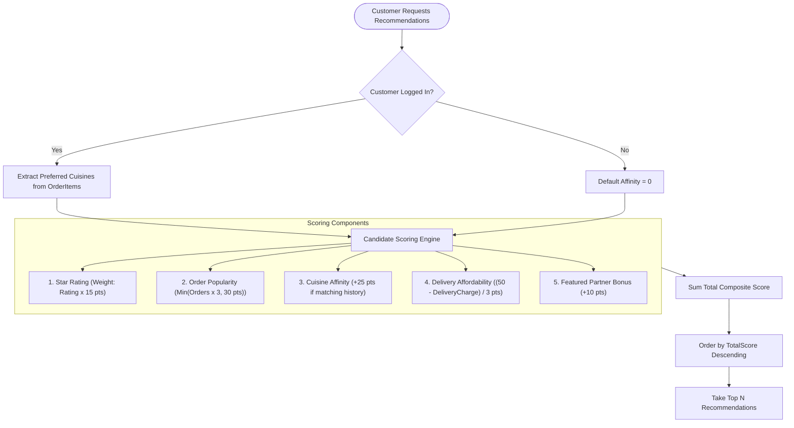

# QuickEats - Smart Discovery & Recommendation Engine

## 1. Overview & Architectural Goals
In standard food delivery platforms, homepage listing is often either hardcoded or a simple `SELECT * FROM Restaurants ORDER BY Id DESC`. QuickEats implements a **dual-mode intelligent discovery engine**:
1. **Personalized Preference Engine:** Recommends restaurants using collaborative past-order affinity, average user review sentiment, popularity volume, and delivery affordability.
2. **Geospatial Proximity Search:** Calculates real-time physical distance between the customer's coordinates and restaurant kitchens using the spherical **Haversine Great-Circle formula**.

---

## 2. Recommendation Scoring Algorithm

When a customer opens the homepage or recommendation section, the engine executes a multi-factor ranking pipeline:



### Mathematical Scoring Formulation:
$$\text{Score} = (\text{Rating} \times 15) + \min(\text{OrderCount} \times 3, 30) + \text{AffinityBonus} + \max\left(0, \frac{50 - \text{DeliveryCharge}}{3}\right) + \text{FeaturedBonus}$$

---

## 3. Backend C# Implementation (`RestaurantRepository.cs`)

```csharp
public async Task<IEnumerable<Restaurant>> GetRecommendedAsync(int? customerId, int count)
{
    var activeRestaurants = await _context.Restaurants
        .AsNoTracking()
        .Where(r => r.IsActive)
        .ToListAsync();

    // 1. Extract customer's preferred cuisines from previous orders
    List<string> preferredCuisines = new();
    if (customerId.HasValue && customerId.Value > 0)
    {
        preferredCuisines = await _context.OrderItems
            .Where(oi => oi.Order.UserId == customerId.Value)
            .Select(oi => oi.MenuItem.Category)
            .Where(c => !string.IsNullOrEmpty(c))
            .Distinct()
            .ToListAsync();
    }

    var restaurantIds = activeRestaurants.Select(r => r.Id).ToList();

    // 2. Fetch order volume and review ratings in batch
    var orderCounts = await _context.Orders
        .Where(o => restaurantIds.Contains(o.RestaurantId))
        .GroupBy(o => o.RestaurantId)
        .Select(g => new { RestaurantId = g.Key, Count = g.Count() })
        .ToDictionaryAsync(x => x.RestaurantId, x => x.Count);

    var avgRatings = await _context.Reviews
        .Where(rv => restaurantIds.Contains(rv.RestaurantId))
        .GroupBy(rv => rv.RestaurantId)
        .Select(g => new { RestaurantId = g.Key, Avg = g.Average(r => (double)r.Rating) })
        .ToDictionaryAsync(x => x.RestaurantId, x => x.Avg);

    var restaurantCuisines = await _context.MenuItems
        .Where(m => restaurantIds.Contains(m.RestaurantId) && m.IsAvailable)
        .GroupBy(m => m.RestaurantId)
        .Select(g => new { RestaurantId = g.Key, Categories = g.Select(m => m.Category).Distinct().ToList() })
        .ToDictionaryAsync(x => x.RestaurantId, x => x.Categories);

    // 3. Score every active restaurant
    var scored = activeRestaurants.Select(r =>
    {
        double score = 0;
        
        // Base score from rating (0-5 stars -> 0 to 75 points)
        double rating = avgRatings.TryGetValue(r.Id, out var rAvg) ? rAvg : 3.5;
        score += rating * 15;

        // Popularity bonus from actual order volume (max 30 points)
        int orders = orderCounts.TryGetValue(r.Id, out var oCount) ? oCount : 0;
        score += Math.Min(orders * 3, 30);

        // Cuisine preference affinity (+25 points if matches past tastes)
        if (preferredCuisines.Count > 0 && restaurantCuisines.TryGetValue(r.Id, out var cats))
        {
            if (cats.Any(c => preferredCuisines.Contains(c, StringComparer.OrdinalIgnoreCase)))
            {
                score += 25;
            }
        }

        // Delivery charge affordability bonus (free or cheap delivery gets up to 16.6 pts)
        score += Math.Max(0, (50 - (double)r.DeliveryCharge) / 3.0);

        // Featured partner bonus (+10 pts)
        if (r.IsFeatured) score += 10;

        return new { Restaurant = r, Score = score };
    });

    return scored
        .OrderByDescending(x => x.Score)
        .Take(count)
        .Select(x => x.Restaurant)
        .ToList();
}
```

---

## 4. Geospatial Proximity Engine (Haversine Formula)

When the user grants browser geolocation permission, the frontend transmits latitude and longitude. The backend computes great-circle distance in kilometres.

### Haversine Formula:
$$d = 2R \cdot \arcsin\left(\sqrt{\sin^2\left(\frac{\Delta\phi}{2}\right) + \cos(\phi_1)\cos(\phi_2)\sin^2\left(\frac{\Delta\lambda}{2}\right)}\right)$$
- $R = 6371 \text{ km}$ (Mean radius of Earth)
- $\phi_1, \phi_2$: Latitude in radians
- $\lambda_1, \lambda_2$: Longitude in radians

### C# Implementation: `RestaurantService.cs`
```csharp
private static double HaversineDistanceKm(double lat1, double lon1, double lat2, double lon2)
{
    const double EarthRadiusKm = 6371.0;

    double dLat = DegreesToRadians(lat2 - lat1);
    double dLon = DegreesToRadians(lon2 - lon1);

    double a = Math.Sin(dLat / 2.0) * Math.Sin(dLat / 2.0) +
               Math.Cos(DegreesToRadians(lat1)) * Math.Cos(DegreesToRadians(lat2)) *
               Math.Sin(dLon / 2.0) * Math.Sin(dLon / 2.0);

    double c = 2.0 * Math.Atan2(Math.Sqrt(a), Math.Sqrt(1.0 - a));
    return EarthRadiusKm * c;
}

private static double DegreesToRadians(double degrees) => degrees * (Math.PI / 180.0);
```

### Proximity Filtering Logic:
```csharp
public async Task<IEnumerable<RestaurantResponseDto>> GetNearbyAsync(
    double latitude, double longitude, double radiusKm, int count)
{
    // 1. Strict coordinate bounds validation
    if (latitude is < -90 or > 90) throw new BadRequestException("Invalid latitude.");
    if (longitude is < -180 or > 180) throw new BadRequestException("Invalid longitude.");
    if (radiusKm <= 0 || radiusKm > 100) throw new BadRequestException("Radius must be between 1-100 km.");

    // 2. Fetch restaurants with coordinates
    var candidates = await _restaurantRepository.GetWithCoordinatesAsync();
    var nearby = new List<(Restaurant Restaurant, double DistanceKm)>();

    // 3. Filter within radius
    foreach (var restaurant in candidates)
    {
        var distance = HaversineDistanceKm(latitude, longitude, restaurant.Latitude!.Value, restaurant.Longitude!.Value);
        if (distance <= radiusKm)
        {
            nearby.Add((restaurant, distance));
        }
    }

    // 4. Return sorted by proximity (nearest first)
    return nearby
        .OrderBy(n => n.DistanceKm)
        .Take(count)
        .Select(n => MapToDto(n.Restaurant, null, n.DistanceKm));
}
```

---

## 5. Interview Talking Points

### Q1: Why calculate Haversine distance in memory instead of in the SQL database?
**Answer:** While SQL Server provides `geography::STDistance`, evaluating spatial functions directly in EF Core often requires spatial extensions (`NetTopologySuite`) and can bypass database indexes if not specifically configured. By pre-filtering active restaurants with non-null coordinates into memory, computing the mathematical Haversine formula in C# executes in sub-millisecond time for hundreds of candidates, avoiding database CPU contention.

### Q2: How does the recommendation engine prevent cold-start problems for new users?
**Answer:** When a customer has no prior order history (`preferredCuisines.Count == 0`), the affinity bonus defaults to `0`. The algorithm smoothly falls back to a blend of verified review ratings, total order volume, low delivery fees, and featured partner status, ensuring new users always see the highest quality, most popular restaurants.
