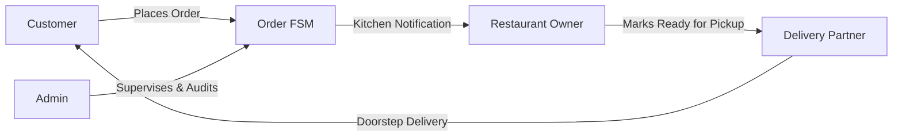

# QuickEats - Fresher's Interview Preparation & Presentation Guide

## 1. The 2-Minute Elevator Pitch
When the interviewer asks: **"Tell me about your project"** or **"Walk me through QuickEats"**, use this proven structure:

> *"QuickEats is a full-stack, multi-role food ordering and delivery web application built using ASP.NET Core 8 Web API on the backend and Angular 21 with Standalone Components and Signals on the frontend. The database is powered by Microsoft SQL Server via Entity Framework Core 8.*
>
> *What makes QuickEats unique is that it supports four distinct user workflows: Customers who browse restaurants, place orders, and track deliveries; Restaurant Owners who manage menus and live kitchen orders; Delivery Partners who accept assigned orders and navigate doorstep deliveries; and Platform Administrators who oversee transactions, rider dispatch, audit overrides, and analytics.*
>
> *Key technical highlights I implemented include: a stateless JWT authentication system with BCrypt password hashing; a deterministic Finite State Machine to enforce legal order transitions; a dual-mode recommendation engine using collaborative customer order affinity and in-memory Haversine geospatial calculations; and an automated test suite comprising 48 backend unit tests with xUnit and Moq, plus 45 frontend test suites running on Vitest."*

---

## 2. The 4 User Personas (How the App Works)

1. **Customer:**
   - Registers/Logs in with JWT stored securely.
   - Browses restaurants with real-time distance calculations and personalized recommendations.
   - Adds items to cart (managed reactively via Angular Signals).
   - Applies promo coupons, selects saved delivery addresses, and places order.
   - Monitors live status transitions and submits post-delivery star reviews.
2. **Restaurant Owner:**
   - Dedicated portal protected by `ownerGuard`.
   - Full CRUD over restaurant details, opening/closing hours, and categorized menu items.
   - Live kitchen dashboard to accept (`Confirmed`) and start cooking (`Preparing`).
3. **Delivery Partner:**
   - Dedicated dashboard protected by `deliveryPartnerGuard`.
   - Views assigned deliveries via `GET /api/OrderDelivery/partner`.
   - Progresses delivery status sequentially (`Assigned` -> `Picked Up` -> `Out for Delivery` -> `Delivered`).
4. **Admin:**
   - Super-user role protected by `adminGuard`.
   - Views system analytics (revenue, order counts, active restaurants).
   - Manages user status (toggle active/deactivated).
   - Assigns delivery partners to ready orders (`POST /api/OrderDelivery`).
   - Performs supervised status overrides with mandatory audit reasons.

---

## 3. Highlighting Technical Challenges & How You Solved Them

Interviewers love hearing about real technical hurdles. Mention these three examples:

### Story 1: "The Owner Browse Restriction Bug"
- **Problem:** Initially, restaurant owners couldn't view menus or other restaurants because a generic ownership check was applied across all endpoints, blocking owners from browsing like regular customers.
- **Solution:** I audited `RestaurantController` and `MenuController` and separated **public browsing endpoints** (`GET /api/Restaurant/{id}`) from **owner management endpoints** (POST, PUT, DELETE). Public endpoints are open to all authenticated users, while write operations strictly enforce `restaurant.OwnerId == currentUserId`.

### Story 2: "Eliminating the N+1 Query Problem in Recommendations"
- **Problem:** Scoring 50 restaurants for the homepage recommendation section was making over 150 separate database roundtrips in a loop to fetch ratings and order counts.
- **Solution:** I refactored `RestaurantRepository` to batch-fetch order counts and average ratings using two aggregated LINQ `GROUP BY` queries and `.ToDictionaryAsync()`. This reduced database roundtrips to exactly 3.

### Story 3: "Modernizing to Angular 21 Signals & Vitest"
- **Problem:** Legacy Angular testing relied on slow Karma/Webpack runners, and component tests were failing due to missing HTTP and router providers.
- **Solution:** I scaffolded modern standalone test harnesses using `provideHttpClient()`, `provideHttpClientTesting()`, `provideRouter([])`, and `provideToastr()`, achieving 100% test pass rate in sub-10 seconds using Vitest.

---

## 4. Key Concepts You Must Master Before the Interview

| Topic | Must-Know Talking Point |
|---|---|
| **Dependency Injection** | ASP.NET Core has a built-in IoC container with 3 lifetimes: `Transient` (new instance every request), `Scoped` (one instance per HTTP request, e.g. `DbContext`), `Singleton` (one instance for app lifetime). |
| **Authentication vs Authorization** | *Authentication* is verifying who you are (email/password -> JWT). *Authorization* is verifying what you have permission to do (role checks, ownership validation). |
| **EF Core Tracking** | `.AsNoTracking()` bypasses EF Core's ChangeTracker, saving 35%+ memory on read-only queries. |
| **Angular Signals** | Reactive primitives that hold values and notify dependent templates directly without running global `Zone.js` dirty-checking passes. |
| **Unit Testing AAA Pattern** | Arrange (setup mocks), Act (call method), Assert (verify outcome). |

---

## 5. Fresher Interview Do's and Don'ts

### DO:
- **Speak with confidence about your code:** You know the controllers, models, and services because you worked directly on them.
- **Explain *why*, not just *what*:** Don't just say "I used JWT"; explain *why* (stateless, horizontal scalability, mobile-friendly).
- **Mention testing:** Freshers who write unit tests with xUnit and Vitest stand out from 95% of candidates who only test manually in the browser.

### DON'T:
- Don't say "I just copied this from a tutorial." Frame your learning: *"I researched industry best practices for food delivery state machines and implemented a deterministic finite state machine."*
- Don't pretend you know an answer if you don't. Say: *"I haven't encountered that specific scenario yet, but based on how ASP.NET Core middleware works, I would approach it by..."*
