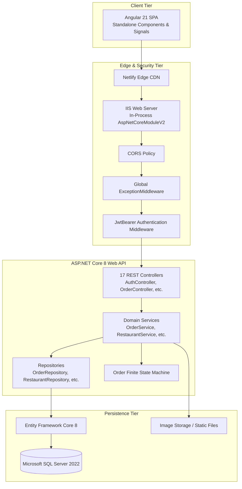
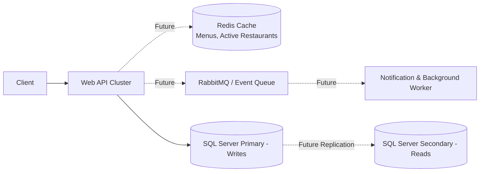

# QuickEats - System Design Deep Dive

## 1. High-Level Architecture
QuickEats is designed around a **modular N-Tier Clean Architecture** separating concerns between Presentation, Domain Business Logic, and Data Persistence.

---

## 2. Low-Level Component Responsibilities

### 2.1 Presentation & API Controllers
- **Role:** Pure HTTP entry points.
- **Rules:**
  - Zero SQL or database queries in controllers.
  - Zero business logic (e.g. calculation of taxes, state machine checks).
  - Validates model binding (`[FromBody]`, `[FromQuery]`).
  - Checks role authorization and resource ownership.
  - Delegates execution to the corresponding domain service.

### 2.2 Domain Business Services (`QuickEats.API.Services`)
- **Role:** Orchestrates business operations and enforces business invariants.
- **Examples:**
  - `OrderService`: Enforces legal status transitions, calculates order totals, validates cancellation rules, dispatches in-app notifications.
  - `RestaurantService`: Executes Haversine distance calculations, bounds checks, validates operating hours.
  - `UserService`: Hashes passwords via `PasswordHasher`, verifies credentials, checks active account status.

### 2.3 Data Access Repositories (`QuickEats.API.Repositories`)
- **Role:** Abstracts EF Core database interactions.
- **Rules:**
  - Implements interface contracts (`IRestaurantRepository`, `IOrderRepository`).
  - Utilizes `.AsNoTracking()` on read-only queries.
  - Manages batch fetching and SQL projections to avoid N+1 query overhead.

---

## 3. Delivery Workflow & State Invariants

### 3.1 Admin Dispatch & Partner State Transitions
In QuickEats, delivery partner assignment is an administrative operation rather than an uncoordinated gig race.
- **Admin Assignment Validation (`OrderDeliveryService.CreateAsync`):**
  - Verifies the order is in `Ready for Pickup` status (or in `Assigned` status if reassigning a delivery partner before food pickup).
  - Validates that the selected delivery partner exists and is marked active (`partner.IsActive`).
  - Sets or reassigns the `OrderDelivery` entity with status `Assigned` and synchronizes `Order.Status = "Assigned"`.
- **Rider Status Progression (`OrderDeliveryService.UpdateStatusAsync`):**
  - Verifies caller identity: only the assigned delivery partner (`delivery.DeliveryPartnerId == currentUserId`) is permitted to update the delivery status.
  - Enforces strictly sequential stage progression: `Assigned` -> `Picked Up` -> `Out for Delivery` -> `Delivered`.
  - Disallows skipping stages or modifying completed deliveries.
  - Automatically synchronizes `Order.Status`, sets timestamps (`PickedUpAt`, `DeliveredAt`), and triggers customer in-app notifications.

---

## 4. Scaling Architecture (Future Roadmap — Not Implemented in Current Release)

> [!NOTE]
> The components described in this section (**Redis distributed caching**, **RabbitMQ message queuing**, and **SignalR real-time WebSockets**) are planned architectural roadmap milestones and are **not implemented** in the current QuickEats codebase. The current application runs on a 3-tier architecture with direct SQL Server queries, synchronous REST calls, and database-persisted notifications.

1. **Distributed Caching (Redis) — *Future Roadmap*:**
   - Cache popular restaurant menus and active catalog lists with TTL invalidation to reduce database read load during peak meal times.
2. **Asynchronous Message Queue (RabbitMQ / Azure Service Bus) — *Future Roadmap*:**
   - Decouple notification dispatching, external payment webhooks, and reporting into asynchronous background queue consumers.
3. **Real-Time WebSockets (SignalR) — *Future Roadmap*:**
   - Push live delivery status and driver location coordinates to the customer map view instead of polling or manual refresh.
4. **Read-Replica Database Scaling — *Future Roadmap*:**
   - Route all read-only queries configured with `.AsNoTracking()` to a dedicated read replica, reserving the primary database instance strictly for order transactions and payment writes.
