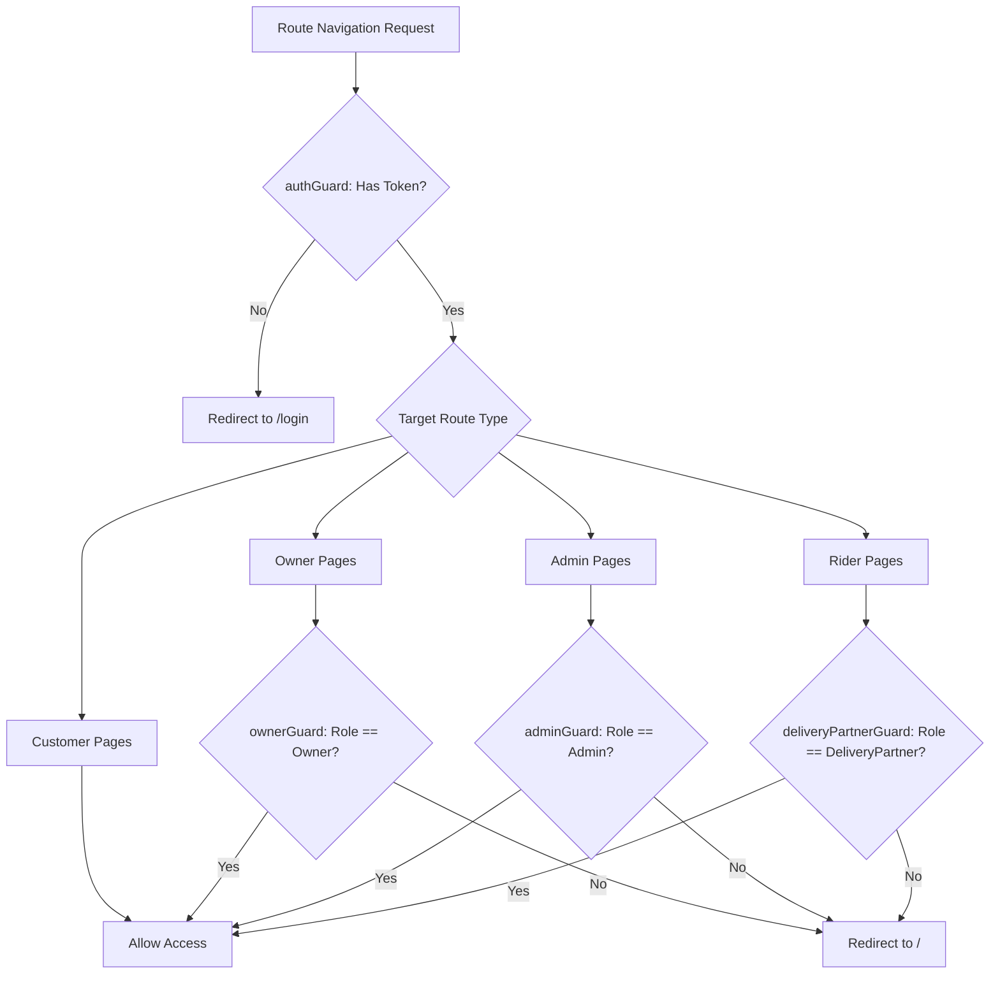

# QuickEats - Role-Based Access Control (RBAC) Matrix

## 1. Overview
QuickEats enforces strict security boundaries using **Role-Based Access Control (RBAC)** complemented by **Data-Level Ownership Checks (anti-IDOR)**.

### The 5 Access Personas:
1. **Anonymous / Guest:** Unauthenticated public visitors browsing the food catalog.
2. **Customer:** End-users ordering food, saving addresses, and reviewing orders.
3. **Owner:** Restaurant proprietors managing their own restaurants, menus, and incoming kitchen orders.
4. **Delivery Partner (Rider):** Gig workers picking up food and completing doorstep deliveries.
5. **Administrator:** System operators with platform-wide oversight and emergency override capabilities.

---

## 2. Granular Permissions Matrix

| Endpoint Group | Action | Guest | Customer | Owner | Delivery Partner | Admin |
|---|---|:---:|:---:|:---:|:---:|:---:|
| **Auth** | Register / Login | ✅ | ✅ | ✅ | ✅ | ✅ |
| **Restaurants** | Browse All / Filter / Nearby | ✅ | ✅ | ✅ | ✅ | ✅ |
| | View Restaurant Details & Menu | ✅ | ✅ | ✅ | ✅ | ✅ |
| | Create New Restaurant | ⠌ | ⠌ | ✅ | ⠌ | ✅ |
| | Edit / Delete Restaurant | ⠌ | ⠌ | ✅ *(Own only)* | ⠌ | ✅ *(Any)* |
| | Toggle Active / Featured Flag | ⠌ | ⠌ | ⠌ | ⠌ | ✅ |
| **Menu Items** | Browse Food Items | ✅ | ✅ | ✅ | ✅ | ✅ |
| | Add / Update / Delete Item | ⠌ | ⠌ | ✅ *(Own only)* | ⠌ | ✅ *(Any)* |
| | Toggle Availability In-Stock | ⠌ | ⠌ | ✅ *(Own only)* | ⠌ | ✅ *(Any)* |
| **Cart & Ordering**| Manage Local Cart (Signals) | ✅ | ✅ | ⠌ | ⠌ | ⠌ |
| | Place Order (`POST /api/Order`)| ⠌ | ✅ | ⠌ | ⠌ | ⠌ |
| | View Order History | ⠌ | ✅ *(Own)* | ✅ *(Own rest.)*| ⠌ | ✅ *(All)* |
| | Cancel Order (Pending/Confirmed)| ⠌ | ✅ *(Own)* | ✅ *(Own rest.)*| ⠌ | ✅ *(Any)* |
| | Update Status to Preparing/Ready| ⠌ | ⠌ | ✅ *(Own rest.)*| ⠌ | ✅ |
| | Emergency Status Override | ⠌ | ⠌ | ⠌ | ⠌ | ✅ *(Audited)* |
| **Deliveries** | View All Platform Deliveries | ⠌ | ⠌ | ⠌ | ⠌ | ✅ |
| | View Assigned Deliveries | ⠌ | ⠌ | ⠌ | ✅ *(Assigned)* | ⠌ |
| | View Delivery Details by ID | ⠌ | ✅ *(Own order)* | ⠌ | ✅ *(Assigned)* | ✅ |
| | Assign Delivery Partner (`POST`)| ⠌ | ⠌ | ⠌ | ⠌ | ✅ |
| | Advance Delivery Status (`PUT`)| ⠌ | ⠌ | ⠌ | ✅ *(Assigned)* | ⠌ |
| | Delete Delivery (`DELETE`) | ⠌ | ⠌ | ⠌ | ⠌ | ✅ |
| **Reviews & Ratings**| Read Customer Reviews | ✅ | ✅ | ✅ | ✅ | ✅ |
| | Post Review & Star Rating | ⠌ | ✅ *(Verified)* | ⠌ | ⠌ | ⠌ |
| | Delete Review | ⠌ | ⠌ | ⠌ | ⠌ | ✅ |
| **Saved Addresses**| Manage Address Book | ⠌ | ✅ *(Own)* | ⠌ | ⠌ | ⠌ |
| **Wishlist & Favs**| Bookmark Items & Restaurants | ⠌ | ✅ *(Own)* | ⠌ | ⠌ | ⠌ |
| **Admin Analytics**| Dashboard Metrics & Users | ⠌ | ⠌ | ⠌ | ⠌ | ✅ |

---

## 3. Frontend Route Guard Enforcement

