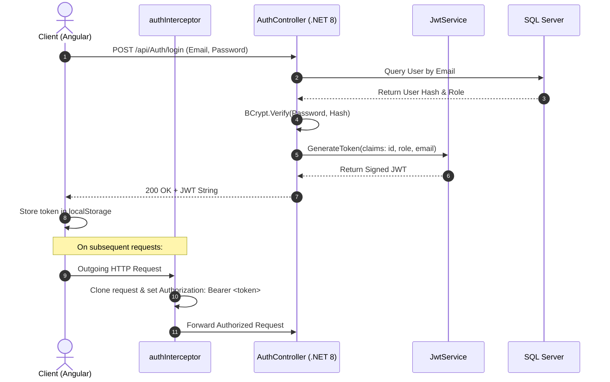
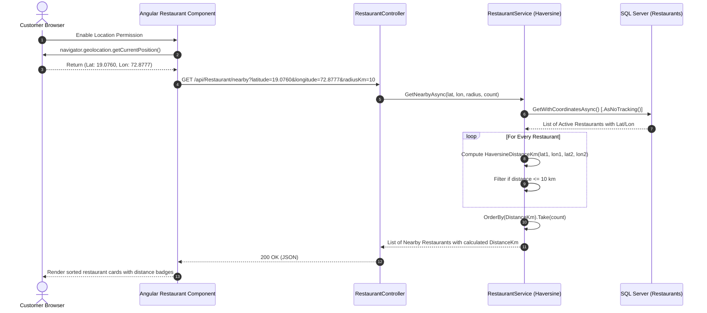
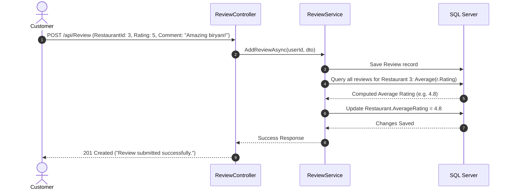

# QuickEats - Data Flow Diagrams (DFDs)

## 1. Authentication & Token Injection Flow



---

## 2. Geospatial Proximity & Discovery Flow



---

## 3. Order Lifecycle & Delivery Fulfillment Flow

```mermaid
sequenceDiagram
    autonumber
    actor Customer as Customer
    actor Owner as Restaurant Owner
    actor Admin as Platform Admin
    actor Rider as Delivery Partner
    participant OrderAPI as OrderController & OrderService
    participant DeliveryAPI as OrderDeliveryController & OrderDeliveryService
    participant DB as SQL Server

    Customer->>OrderAPI: POST /api/Order (Items, DeliveryAddress, Phone)
    OrderAPI->>DB: Validate Restaurant & Items; Save Order (Status: "Pending")
    OrderAPI-->>Customer: Order Created (#1042)

    Owner->>OrderAPI: PUT /api/Order/1042 (Status: "Confirmed")
    OrderAPI->>DB: Update Order (Status: "Confirmed")
    Owner->>OrderAPI: PUT /api/Order/1042 (Status: "Preparing")
    OrderAPI->>DB: Update Order (Status: "Preparing")
    Owner->>OrderAPI: PUT /api/Order/1042 (Status: "Ready for Pickup")
    OrderAPI->>DB: Update Order (Status: "Ready for Pickup")

    Admin->>DeliveryAPI: POST /api/OrderDelivery (OrderId: 1042, DeliveryPartnerId: 5)
    DeliveryAPI->>DB: Save OrderDelivery (Status: "Assigned"), Update Order (Status: "Assigned")
    DeliveryAPI->>Customer: Notification ("Assigned to delivery partner")

    Rider->>DeliveryAPI: PUT /api/OrderDelivery/{id} (DeliveryStatus: "Picked Up")
    DeliveryAPI->>DB: Update DeliveryStatus="Picked Up", OrderStatus="Picked Up", PickedUpAt=UtcNow
    DeliveryAPI->>Customer: Notification ("Delivery Status: Picked Up")

    Rider->>DeliveryAPI: PUT /api/OrderDelivery/{id} (DeliveryStatus: "Out for Delivery")
    DeliveryAPI->>DB: Update DeliveryStatus="Out for Delivery", OrderStatus="Out for Delivery"
    DeliveryAPI->>Customer: Notification ("Delivery Status: Out for Delivery")

    Rider->>DeliveryAPI: PUT /api/OrderDelivery/{id} (DeliveryStatus: "Delivered")
    DeliveryAPI->>DB: Update DeliveryStatus="Delivered", OrderStatus="Delivered", DeliveredAt=UtcNow
    DeliveryAPI->>Customer: Notification ("Order #1042 Delivered!")
```

---

## 4. Review & Rating Re-computation Flow


