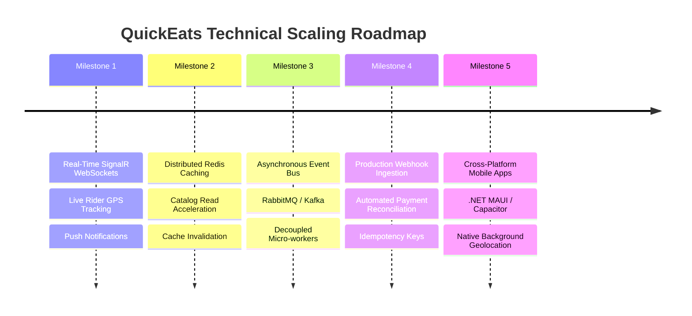

# QuickEats - Future Enhancements & Technical Roadmap

## 1. Overview
The QuickEats architecture has been designed with modular Clean Architecture principles, making it straightforward to scale and extend with enterprise-grade capabilities. This roadmap highlights five strategic technical enhancements.

---

## 2. Roadmap Milestone Details

---

### Milestone 1: Real-Time WebSockets via ASP.NET Core SignalR
- **Current State:** Frontend uses interval polling or page refreshes to monitor order status updates.
- **Enhancement:** Implement an `OrderHub : Hub` in ASP.NET Core:
  - When an Owner updates status to `Preparing` or `Ready for Pickup`, the server pushes an instant WebSocket event to the customer's browser.
  - When a Delivery Partner's mobile device transmits GPS coordinates, the customer's delivery tracking map updates smoothly in real time without polling.

---

### Milestone 2: Distributed Caching with Redis
- **Current State:** Catalog queries query Microsoft SQL Server directly using `.AsNoTracking()`.
- **Enhancement:** Deploy a Redis instance:
  - Cache frequently requested restaurant menus with a 10-minute Time-To-Live (TTL).
  - Use cache-aside pattern: check Redis first; if cache miss, query SQL Server and populate Redis.
  - Invalidate cache automatically when an Owner modifies a menu item.
  - Reduces database read pressure by up to 80% during peak meal hours.

---

### Milestone 3: Asynchronous Event Bus (RabbitMQ / Azure Service Bus)
- **Current State:** Creating an order triggers database writes and synchronous in-app notification creations in the same HTTP thread.
- **Enhancement:** Adopt event-driven architecture for background tasks:
  - Publishing an `OrderCreatedEvent` to a message queue.
  - Dedicated background consumers handle non-blocking tasks: sending transactional emails, calculating promotional loyalty points, and broadcasting rider dispatch requests.

---

### Milestone 4: Production Payment Webhooks & Idempotency
- **Current State:** Payment initiation is verified through client-side API callback.
- **Enhancement:**
  - Implement secure server-to-server Webhook listeners (`POST /api/Payment/webhook`) verifying Razorpay / Stripe cryptographic HMAC signatures.
  - Implement **Idempotency Keys** (`Idempotency-Key` header) to guarantee that network retries never double-charge a customer.

---

### Milestone 5: Cross-Platform Mobile Apps (.NET MAUI / Capacitor)
- **Current State:** Fully responsive web application accessible via mobile browsers.
- **Enhancement:**
  - Package the existing Angular frontend into native iOS and Android apps using **Capacitor**, or build a dedicated Rider companion app in **.NET MAUI**.
  - Enable native OS capabilities: background GPS location services, push notifications (FCM / APNs), and Bluetooth thermal receipt printing for restaurant kitchens.
